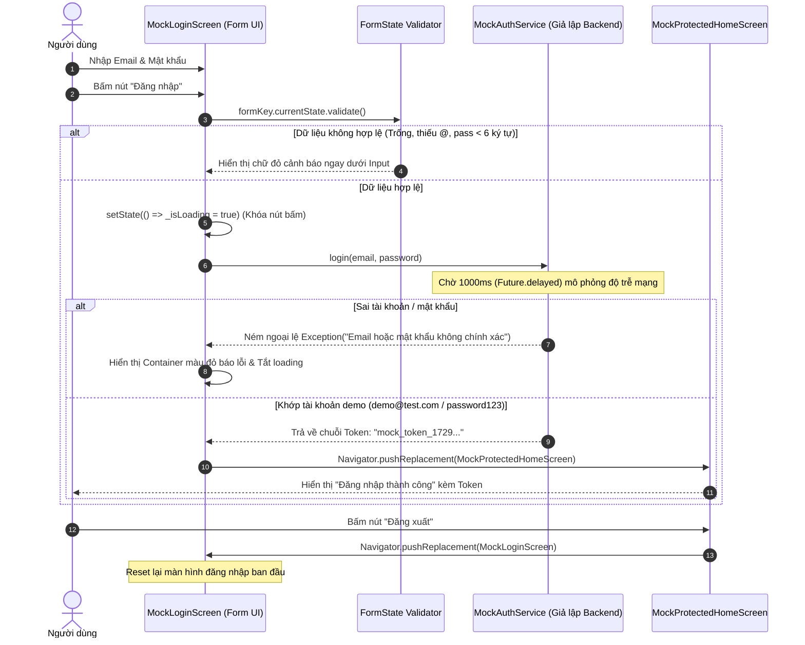
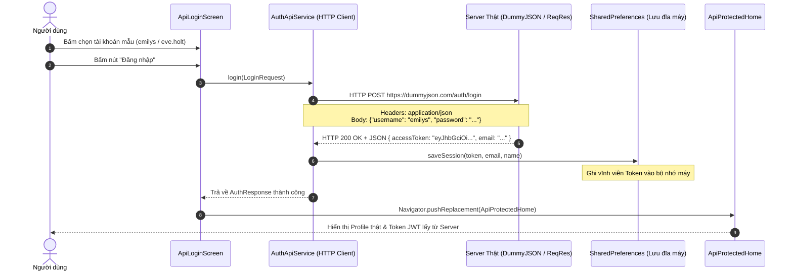
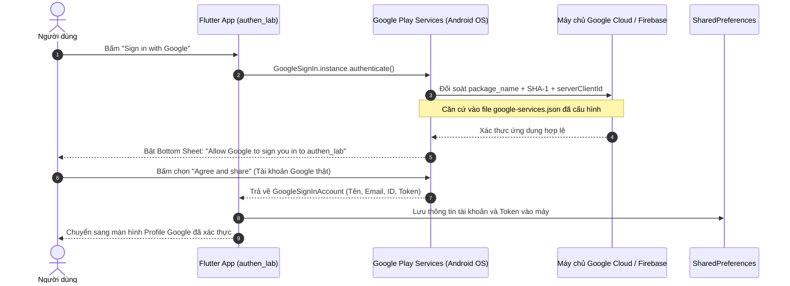

# TÀI LIỆU HƯỚNG DẪN CHẠY & GIẢI THÍCH FLOW THUYẾT TRÌNH (MODULE 10)
> **Chủ đề:** Authentication, Session Management & Google Sign-In

---

## 1. TỔNG QUAN KIẾN TRÚC 3 CẤP ĐỘ BẢO MẬT (LAB 10)

Bài thực hành Authentication được thiết kế theo lộ trình chuẩn, tiến hóa qua 3 cấp độ:

```
[ Cấp độ 1: Mock Auth ] ───► [ Cấp độ 2: Real REST API ] ───► [ Cấp độ 3: Google OAuth 2.0 ]
  (DartPad - State/Logic)        (HTTP POST & JWT Token)          (Google Play Services)
```

| Cấp độ | Mục tiêu đề bài | Môi trường kết nối | Quản lý phiên (Session) | File source code |
| :--- | :--- | :--- | :--- | :--- |
| **Câu 1: Mock Auth** | Form validation, Async, Mock Service | DartPad / Standalone | Biến trạng thái State | `lib/question1_mock/mock_auth_dartpad.dart` |
| **Câu 2: Real API** | HTTP POST, JWT Token, JSON Parsing | DummyJSON & ReqRes | `SharedPreferences` (Lưu đĩa) | `lib/question2_api/` |
| **Câu 3: Google Sign-In** | Xác thực bên thứ ba, OAuth 2.0 | Google Play Services & Firebase | Google ID Token & Session | `lib/question3_google/` |

---

## 2. HƯỚNG DẪN CHẠY & GIẢI THÍCH CHI TIẾT CODE CÂU 1 (DARTPAD MOCK AUTH)

### 2.1. Hướng dẫn 2 cách chạy Câu 1

#### Cách 1: Chạy trực tiếp trên DartPad (Theo đúng yêu cầu chấm bài của đề)
1. Mở trình duyệt web bất kỳ, truy cập vào trang: **[https://dartpad.dev](https://dartpad.dev)**.
2. Nếu DartPad đang ở chế độ Dart thuần, nhìn góc trên bên phải bấm vào mục **Samples** -> Chọn **Flutter** (hoặc tạo một Flutter project mới).
3. Mở file [mock_auth_dartpad.dart](lib/question1_mock/mock_auth_dartpad.dart), nhấn `Ctrl + A` để copy **toàn bộ 100% nội dung**.
4. Dán đè toàn bộ vào khung soạn thảo của DartPad.
5. Bấm nút **Run** (màu xanh): Giao diện ứng dụng đăng nhập sẽ hiển thị ngay lập tức trên khung preview bên phải của trình duyệt mà không cần cài đặt bất kỳ thư viện nào!

#### Cách 2: Chạy trong ứng dụng Flutter trên Android Emulator / Web
1. Khởi động app bằng lệnh `flutter run` hoặc bấm Run trong Android Studio.
2. Tại màn hình chính (Portal Menu), bấm vào thẻ **"Câu 1: Mô phỏng xác thực (DartPad)"**.

---

### 2.2. Sơ đồ tuần tự hoạt động (Sequence Diagram - Câu 1)



---

### 2.3. Giải thích chi tiết từng khối Code trong `mock_auth_dartpad.dart`

File code được chia thành **4 khối logic độc lập**, rõ ràng:

#### 🔹 Khối 1: Cấu hình Standalone App (`void main()` & `MockAuthApp`)
```dart
void main() {
  runApp(const MockAuthApp());
}
```
* **Ý nghĩa:** File được thiết kế theo chuẩn **Standalone** (độc lập hoàn toàn). Có hàm `main()` riêng để sinh viên hoặc thầy cô có thể copy 1 file duy nhất này lên [dartpad.dev](https://dartpad.dev) chạy được ngay mà không bị thiếu thư viện hay import ngoài.

---

#### 🔹 Khối 2: Tầng Dịch vụ Giả lập Backend (`MockAuthService`)
```dart
class MockAuthService {
  static const String demoEmail = 'demo@test.com';
  static const String demoPassword = 'password123';

  Future<String> login(String email, String password) async {
    // 1. Giả lập độ trễ mạng 1 giây
    await Future.delayed(const Duration(milliseconds: 1000));

    // 2. Kiểm tra thông tin đăng nhập
    if (email.trim().toLowerCase() == demoEmail && password == demoPassword) {
      return 'mock_token_${DateTime.now().millisecondsSinceEpoch}';
    } else {
      throw Exception('Email hoặc mật khẩu không chính xác! (Gợi ý: demo@test.com / password123)');
    }
  }
}
```
* **`Future.delayed(const Duration(milliseconds: 1000))`**: 
  * Đây là điểm cốt lõi của lập trình bất đồng bộ (`asynchronous`). 
  * Vì trong thực tế gọi API qua Internet luôn mất thời gian truyền gói tin (Network Latency), dòng code này giúp app mô phỏng thời gian chờ của server thật.
* **`throw Exception(...)`**:
  * Mô phỏng phản hồi lỗi từ máy chủ (tương đương mã lỗi `HTTP 401 Unauthorized`).
* **`mock_token_...`**:
  * Trả về một chuỗi token có gắn kèm timestamp (`millisecondsSinceEpoch`) để chứng minh mỗi lần đăng nhập thành công là một phiên (Session) duy nhất.

---

#### 🔹 Khối 3: Màn hình Đăng nhập & Xử lý Form (`MockLoginScreen`)
* **Kiểm tra hợp lệ đầu vào (Client-Side Validation):**
  ```dart
  validator: (v) {
    if (v == null || v.trim().isEmpty) return 'Vui lòng nhập email';
    if (!v.contains('@')) return 'Email không hợp lệ';
    return null;
  }
  ```
  * Sử dụng `_formKey.currentState!.validate()`.
  * Kiểm tra dữ liệu ngay tại máy client giúp chặn các request rác trước khi gửi đi, tối ưu tài nguyên mạng.
* **Quản lý trạng thái Loading (`_isLoading`):**
  * Trước khi gọi `_authService.login()`, gọi `setState(() => _isLoading = true)`.
  * Nút bấm chuyển sang hiển thị `CircularProgressIndicator` và bị khóa (`onPressed: _isLoading ? null : _handleLogin`).
  * Tránh lỗi người dùng bấm liên tục nhiều lần (Double Submit).
* **Điều hướng bảo mật với `Navigator.pushReplacement`:**
  ```dart
  Navigator.pushReplacement(
    context,
    MaterialPageRoute(builder: (_) => MockProtectedHomeScreen(...)),
  );
  ```
  * **Tại sao dùng `pushReplacement` thay vì `push`?**  
    `pushReplacement` sẽ **thay thế hoàn toàn** màn hình Login bằng màn hình Home trong Navigation Stack. Khi người dùng đã vào Home, họ bấm phím Back trên điện thoại thì app sẽ thoát ra ngoài chứ không bị quay lùi lại màn hình Login.

---

#### 🔹 Khối 4: Màn hình Bảo vệ & Đăng xuất (`MockProtectedHomeScreen`)
```dart
class MockProtectedHomeScreen extends StatelessWidget {
  final String userEmail;
  final String token;
  ...
}
```
* **Màn hình bảo vệ (Protected Screen):** Chỉ những ai có `token` hợp lệ mới được điều hướng vào đây. Màn hình nhận dữ liệu `userEmail` và `token` truyền qua constructor để hiển thị.
* **Xử lý Đăng xuất (Logout):**
  * Nút Đăng xuất tiếp tục dùng `Navigator.pushReplacement` quay về `MockLoginScreen`.
  * Hủy bỏ phiên làm việc và xóa màn hình Home khỏi bộ nhớ.

---

## 3. FLOW CHI TIẾT QUESTION 2: REAL REST API (DUMMYJSON / REQRES)

### 3.1. Sơ đồ tuần tự (Sequence Diagram - Câu 2)


### 3.2. Điểm cần thuyết minh trước lớp (Câu 2):
1. **API Mạng Thật 100%**: Sử dụng thư viện `http` gửi request qua Internet lên server `https://dummyjson.com/auth/login` (hoặc `reqres.in`).
2. **Cấu trúc Access Token (JWT)**: Nhận chuỗi token 3 phần (`Header.Payload.Signature`) chứng minh danh tính.
3. **Lưu trữ phiên với `SharedPreferences`**: Giúp ứng dụng giữ trạng thái đăng nhập kể cả khi tắt hẳn app bật lại (Auto-login).

---

## 4. FLOW CHI TIẾT QUESTION 3: GOOGLE OAUTH 2.0 (GOOGLE PLAY SERVICES)

### 4.1. Sơ đồ tuần tự (Sequence Diagram - Câu 3)


### 4.2. Điểm mấu chốt để trả lời giảng viên (Câu 3):
1. **Tại sao cần file `google-services.json` và mã SHA-1?**  
   Google OAuth bắt buộc ứng dụng phải định danh qua mã SHA-1 của máy và `serverClientId`. Nhờ đó máy chủ Google mới tin tưởng và cấp quyền cho app lấy thông tin người dùng.
2. **Bảo mật**: App không bao giờ biết hoặc lưu mật khẩu Google của người dùng. Mọi thao tác xác thực diễn ra an toàn qua Google Play Services của hệ điều hành.

---

## 5. BỘ CÂU HỎI VẤN ĐÁP THƯỜNG GẶP KHI CHẤM BÀI LAB 10

### ❓ Câu 1: Sự khác nhau cơ bản giữa Câu 1 (Mock) và Câu 2 (API) là gì?
> **Trả lời:**  
> * **Câu 1 (Mock Auth):** Mọi logic xác thực diễn ra cục bộ trong bộ nhớ RAM của ứng dụng bằng `Future.delayed` và biến so sánh chuỗi, chưa có kết nối mạng và chưa lưu trữ dữ liệu bền vững.
> * **Câu 2 (Real API):** Ứng dụng hoạt động theo mô hình Client - Server thật sự, gửi gói tin HTTP POST qua mạng Internet, nhận mã trạng thái chuẩn (`200 OK` / `401 Unauthorized`), trích xuất JWT Token và lưu trữ lâu dài vào `SharedPreferences`.

### ❓ Câu 2: Tại sao ở Câu 1 khi đăng nhập thành công ta lại dùng `Navigator.pushReplacement` thay vì `Navigator.push`?
> **Trả lời:**  
> Dùng `pushReplacement` để **xóa màn hình Login ra khỏi ngăn xếp điều hướng (Navigation Stack)**. Điều này đảm bảo khi người dùng đã đăng nhập vào màn hình Home, nếu họ nhấn nút Back trên điện thoại thì app sẽ đóng lại chứ không bị lùi ngược về màn hình Login (tránh lỗi bảo mật và trải nghiệm người dùng xấu).

### ❓ Câu 3: Làm thế nào để phân biệt ID Token và Access Token trong Google Sign-In?
> **Trả lời:**  
> * **ID Token (JWT)**: Dùng để **Xác thực (Authentication)** — trả lời câu hỏi *"Người dùng này là ai?"* (chứa tên, email, ảnh đại diện).
> * **Access Token**: Dùng để **Ủy quyền (Authorization)** — cấp quyền cho ứng dụng thay mặt người dùng gọi các dịch vụ khác của Google (như đọc Google Drive, Gmail,...). Trong bài Lab 10, ứng dụng sử dụng ID Token để xác định danh tính sinh viên đăng nhập.
