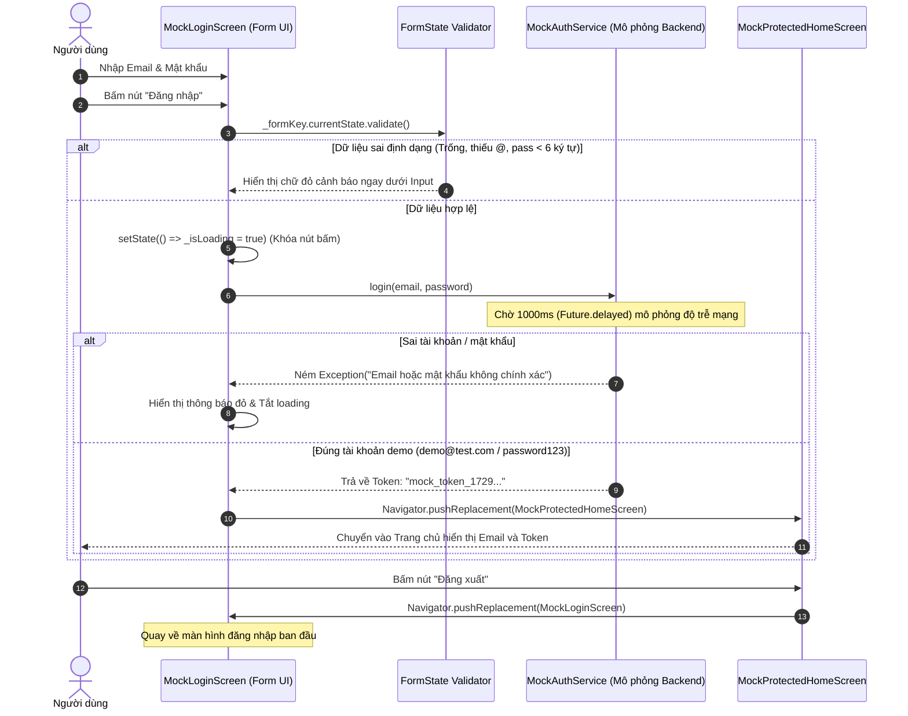
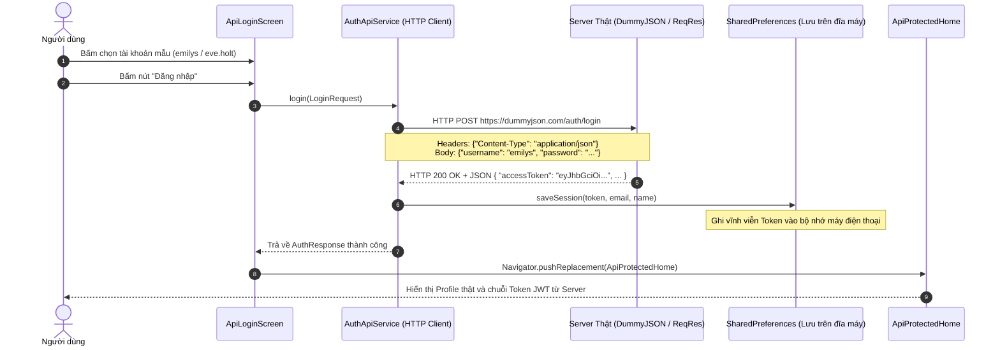
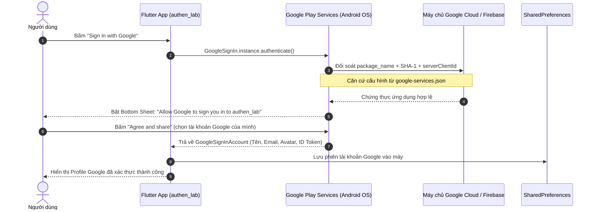

# HƯỚNG DẪN CHẠY & GIẢI THÍCH CHI TIẾT CODE: TOPIC 4 - AUTHENTICATION LAB
> **Chủ đề (Topic 4):** Authentication, Session Management & Google Sign-In (Module 10)

---

## 1. TỔNG QUAN KIẾN TRÚC BÀI THỰC HÀNH (TOPIC 4)

Bài Lab Authentication được thiết kế chuẩn mực theo 3 cấp độ phát triển ứng dụng di động:

```
[ Cấp độ 1: Mock Auth ] ──────► [ Cấp độ 2: Real REST API ] ──────► [ Cấp độ 3: Google OAuth 2.0 ]
  (DartPad - State/Logic)          (HTTP POST & JWT Session)           (Google Play Services)
```

| Cấp độ | Mục tiêu đề bài | Môi trường kết nối | Quản lý phiên (Session) | File mã nguồn chính |
| :--- | :--- | :--- | :--- | :--- |
| **Phần 1: Mock Auth** | Form validation, Async delay, Mock Service | DartPad / Standalone | Bộ nhớ State | `lib/question1_mock/mock_auth_dartpad.dart` |
| **Phần 2: Real API** | HTTP POST, JWT Access Token, JSON Parsing | DummyJSON / ReqRes API | `SharedPreferences` (Lưu đĩa máy) | `lib/question2_api/` |
| **Phần 3: Google Sign-In**| Ủy quyền bên thứ ba, OAuth 2.0, Firebase | Google Play Services | Google ID Token & Session | `lib/question3_google/` |

---

## 2. HƯỚNG DẪN CÁCH CHẠY ỨNG DỤNG

### Cách A: Chạy toàn bộ ứng dụng trên Android Studio / Emulator (Khuyên dùng)
1. Mở **Android Studio** -> Chọn **Open** -> Mở thư mục: `Topic Lab/Authen`.
2. Khởi động máy ảo Android (Pixel 8 API 34).
3. Nhấn nút **Run (Shift + F10)** hoặc chạy lệnh terminal:
   ```bash
   flutter run
   ```
4. Màn hình Portal sẽ xuất hiện với 3 thẻ tương ứng với 3 câu hỏi để bạn bấm vào test trực tiếp.

### Cách B: Chạy riêng Câu 1 trên DartPad (Theo đúng yêu cầu chấm bài trên web của đề)
1. Truy cập trình duyệt vào: **[https://dartpad.dev](https://dartpad.dev)**.
2. Bấm vào mục chọn môi trường ở góc trên, chọn chế độ **Flutter**.
3. Mở file `lib/question1_mock/mock_auth_dartpad.dart`, nhấn `Ctrl + A` copy toàn bộ code.
4. Dán đè vào khung soạn thảo trên DartPad rồi nhấn **Run** (màu xanh). App sẽ hiển thị và chạy mượt mà ngay trên web!

### Cách C: Chạy Test Suite tự động
```bash
flutter test
```
Kiểm tra tính toàn vẹn của cả 3 câu hỏi qua unit test và widget test tự động.

---

## 3. GIẢI THÍCH CHI TIẾT CÁCH CODE HOẠT ĐỘNG (CODE WALKTHROUGH)

---

### PHẦN 1: MOCK AUTHENTICATION (`mock_auth_dartpad.dart`)

#### 1. Sơ đồ tuần tự (Sequence Diagram)


#### 2. Phân tích các khối code cốt lõi

* **Khối Cấu hình Standalone (`void main()` & `MockAuthApp`)**:
  ```dart
  void main() {
    runApp(const MockAuthApp());
  }
  ```
  File chứa sẵn hàm `main()` riêng biệt, không phụ thuộc vào bất kỳ file nào khác trong dự án. Điều này giúp giảng viên có thể copy 1 file duy nhất lên DartPad là chạy được ngay lập tức.

* **Khối Giả lập Dịch vụ (`MockAuthService`)**:
  ```dart
  class MockAuthService {
    static const String demoEmail = 'demo@test.com';
    static const String demoPassword = 'password123';

    Future<String> login(String email, String password) async {
      await Future.delayed(const Duration(milliseconds: 1000));

      if (email.trim().toLowerCase() == demoEmail && password == demoPassword) {
        return 'mock_token_${DateTime.now().millisecondsSinceEpoch}';
      } else {
        throw Exception('Email hoặc mật khẩu không chính xác!');
      }
    }
  }
  ```
  * `Future.delayed(const Duration(milliseconds: 1000))`: Mô phỏng độ trễ truyền dữ liệu qua Internet (Network Latency). Trong thực tế, gọi server luôn mất thời gian, nên đây là kỹ thuật then chốt để kiểm tra trạng thái loading của giao diện.
  * `throw Exception(...)`: Mô phỏng phản hồi lỗi từ server (mã lỗi `401 Unauthorized`).
  * `mock_token_${DateTime.now().millisecondsSinceEpoch}`: Trả về token có gắn mốc thời gian thực để chứng minh mỗi lần đăng nhập tạo ra một phiên làm việc (Session) riêng biệt.

* **Khối Kiểm tra Form & Xử lý Trạng thái (`MockLoginScreen`)**:
  * **Client-side Validation:** Sử dụng `_formKey.currentState!.validate()`. Giúp kiểm tra cú pháp email và độ dài mật khẩu ngay tại máy người dùng trước khi gửi đi, tiết kiệm băng thông mạng.
  * **Chống Double-click (`_isLoading`):** Khi đang gọi service, nút Đăng nhập được set `onPressed: _isLoading ? null : _handleLogin` và hiển thị vòng xoay `CircularProgressIndicator`, ngăn người dùng bấm nhiều lần gây lỗi trùng request.
  * **Điều hướng `Navigator.pushReplacement`:** Thay thế hoàn toàn màn hình Login bằng màn hình Home trong Navigation Stack. Khi người dùng đã vào Trang chủ, nếu bấm phím Back trên điện thoại thì app sẽ thoát ra ngoài chứ không bị quay lùi lại màn hình đăng nhập.

* **Khối Màn hình Bảo vệ (`MockProtectedHomeScreen`)**:
  * Là màn hình chỉ cho phép người dùng đã có token truy cập.
  * Nhận `userEmail` và `token` qua constructor để hiển thị trạng thái phiên.
  * Nút "Đăng xuất" tiếp tục dùng `pushReplacement` quay về `MockLoginScreen` để hủy phiên làm việc.

---

### PHẦN 2: REAL REST API AUTHENTICATION (`question2_api/`)

#### 1. Sơ đồ tuần tự (Sequence Diagram)


#### 2. Phân tích các khối code cốt lõi

* **Tầng Kết nối Mạng (`AuthApiService`)**:
  * Sử dụng thư viện `http` để thực hiện HTTP POST request qua Internet:
    ```dart
    final response = await http.post(
      Uri.parse('https://dummyjson.com/auth/login'),
      headers: {'Content-Type': 'application/json'},
      body: jsonEncode({'username': username, 'password': password}),
    );
    ```
  * Kiểm tra mã phản hồi HTTP: Nếu `response.statusCode == 200`, tiến hành giải mã JSON bằng `jsonDecode(response.body)` sang Object `AuthResponse`. Nếu khác `200`, trích xuất thông báo lỗi từ server để báo cho người dùng.

* **Quản lý Phiên làm việc với `SharedPreferences`**:
  * Khác với Câu 1 chỉ lưu trên biến tạm của RAM, Câu 2 sử dụng `SharedPreferences` để lưu token vào bộ nhớ flash của điện thoại:
    ```dart
    final prefs = await SharedPreferences.getInstance();
    await prefs.setString('jwt_token', token);
    await prefs.setString('user_email', email);
    ```
  * **Tính năng Auto-login:** Khi ứng dụng khởi động lại, hàm `restoreSession()` sẽ đọc token từ `SharedPreferences`. Nếu token còn tồn tại, app sẽ tự động đưa người dùng vào thẳng màn hình Home mà không cần gõ lại mật khẩu.
  * **Đăng xuất (Logout):** Gọi `prefs.clear()` để xóa sạch phiên lưu trữ trước khi chuyển màn hình.

---

### PHẦN 3: GOOGLE SIGN-IN & FIREBASE (`question3_google/`)

#### 1. Sơ đồ tuần tự (Sequence Diagram)


#### 2. Phân tích các khối code cốt lõi

* **Cấu hình Định danh Ứng dụng (`google-services.json` & SHA-1)**:
  * Google OAuth yêu cầu bảo mật 2 lớp: Mã định danh gói (`com.example.authen_lab`) và mã vân tay SHA-1 của máy phát triển (`49:EC:80:0D:AF:...`).
  * Khi bấm đăng nhập, Google Play Services trên điện thoại sẽ kiểm tra xem ứng dụng gọi đến có đúng mã SHA-1 đã đăng ký trên Firebase Console hay không. Nếu trùng khớp, Google mới cho phép mở bảng chọn tài khoản.
* **Tích hợp GoogleSignIn Package (`GoogleAuthService`)**:
  * Sử dụng thư viện chính thức `google_sign_in: ^7.2.0` với cơ chế Credential Manager mới nhất của Android:
    ```dart
    final GoogleSignIn googleSignIn = GoogleSignIn.instance;
    await googleSignIn.initGoogle(
      clientId: defaultWebClientId,
      serverClientId: defaultServerClientId,
    );
    final account = await googleSignIn.authenticate();
    ```
  * `account` trả về thông tin danh tính thật: `displayName`, `email`, `photoUrl`, `id`.
* **Cơ chế Đăng xuất An toàn (Safe Sign-Out)**:
  * Khi người dùng bấm Đăng xuất, app sẽ thực hiện xóa session trong `SharedPreferences` trước, sau đó mới gọi `googleSignIn.signOut()`. Cơ chế này đảm bảo phiên làm việc được giải phóng ngay lập tức kể cả khi mạng chập chờn.

---

## 4. BỘ CÂU HỎI VẤN ĐÁP THƯỜNG GẶP KHI BẢO VỆ VỚI GIẢNG VIÊN

### ❓ Câu 1: Sự khác nhau cơ bản giữa Câu 1 (Mock) và Câu 2 (API) là gì?
> **Trả lời:**  
> * **Câu 1 (Mock Auth):** Xác thực cục bộ trên bộ nhớ RAM bằng cách so sánh chuỗi cố định và dùng `Future.delayed` để giả lập thời gian trễ. Dữ liệu sẽ mất ngay khi tắt app.
> * **Câu 2 (Real API):** Hoạt động theo mô hình Client - Server thật sự qua mạng Internet. Gửi HTTP POST với body JSON, nhận mã phản hồi chuẩn (`200 OK` hoặc `400/401 Error`), nhận chuỗi Access Token (JWT) và lưu trữ bền vững vào bộ nhớ điện thoại bằng `SharedPreferences`.

### ❓ Câu 2: Tại sao khi đăng nhập thành công ta dùng `Navigator.pushReplacement` thay vì `Navigator.push`?
> **Trả lời:**  
> Vì `pushReplacement` sẽ **thay thế màn hình hiện tại trong ngăn xếp điều hướng (Navigation Stack)** thay vì xếp chồng lên. Điều này ngăn người dùng sau khi đã vào Trang chủ nhấn nút Back trên điện thoại bị lùi ngược lại màn hình đăng nhập (tránh lỗi bảo mật và tối ưu trải nghiệm người dùng).

### ❓ Câu 3: JWT (JSON Web Token) là gì và vì sao cần lưu vào `SharedPreferences`?
> **Trả lời:**  
> * **JWT** là một chuỗi mã hóa gồm 3 phần (`Header.Payload.Signature`) dùng để chứng minh người dùng đã được máy chủ xác thực danh tính.
> * Cần lưu vào `SharedPreferences` để app duy trì trạng thái đăng nhập (Session Persistence). Khi người dùng tắt hẳn app và mở lại, app chỉ cần đọc token đã lưu để tự động đăng nhập (Auto-login) mà không bắt người dùng nhập lại mật khẩu.

### ❓ Câu 4: Tại sao tính năng Google Sign-In lại cần file `google-services.json` và mã SHA-1?
> **Trả lời:**  
> Đây là cơ chế bảo mật OAuth 2.0 của Google. Google cần xác minh rằng yêu cầu đăng nhập thực sự đến từ ứng dụng Flutter được xây dựng trên máy tính của lập trình viên được ủy quyền (thông qua mã băm SHA-1) và đúng `package_name`. Nếu không có file này hoặc sai SHA-1, Google sẽ từ chối cấp quyền để ngăn chặn kẻ xấu tạo app giả mạo đánh cắp tài khoản Google.

### ❓ Câu 5: Phân biệt ID Token và Access Token trong Google Sign-In?
> **Trả lời:**  
> * **ID Token (JWT)**: Dùng để **Xác thực (Authentication)** — trả lời câu hỏi *"Người dùng này là ai?"* (chứa tên, email, ảnh đại diện để app hiển thị).
> * **Access Token**: Dùng để **Ủy quyền (Authorization)** — cấp quyền cho ứng dụng thay mặt người dùng gọi các dịch vụ khác của Google (như Google Drive, Calendar, Gmail). Trong bài Lab này, chúng ta chỉ cần ID Token để xác thực người dùng.
